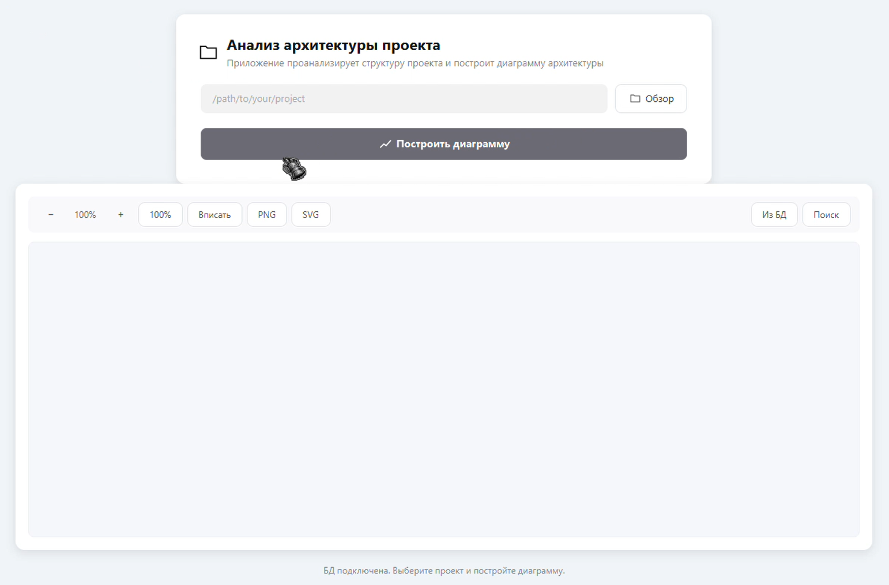
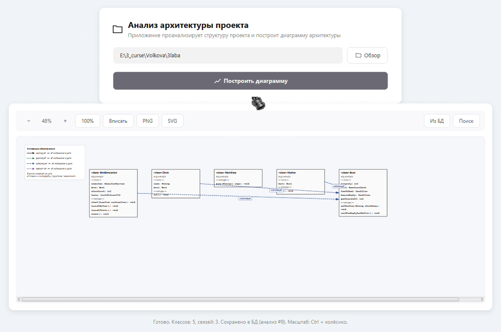

# 🧩 Система визуализации архитектуры программных Java-проектов

Настольное приложение для автоматизированного анализа исходного кода Java-проектов и визуального представления их внутренней структуры и взаимосвязей между программными компонентами.

Система позволяет анализировать исходные файлы, определять классы, интерфейсы, их поля, методы и отношения между ними, а затем формировать интерактивную архитектурную диаграмму.

**Статус проекта:** В разработке.

## 🛠 Технологический стек

- **Java 17** - основной язык программирования.
- **JavaFX** - разработка графического интерфейса настольного приложения.
- **JavaParser** - синтаксический анализ исходного кода Java (AST).
- **MariaDB** - хранение результатов анализа проектов.
- **JDBC** - взаимодействие с базой данных.
- **Maven** - управление зависимостями и сборка проекта.
- **JUnit 5** - модульное тестирование.
- **BootstrapFX** - стилизация элементов интерфейса.

## ✨ Основные возможности

### Анализ программных проектов
- Загрузка Java-проекта из локальной директории.
- Автоматическое сканирование исходных файлов `.java`.
- Определение классов и интерфейсов.
- Извлечение информации о полях и методах.
- Обнаружение наследования и реализации интерфейсов.
- Определение ассоциаций и зависимостей между компонентами.

### Визуализация архитектуры
- Автоматическое построение диаграммы на основе результатов анализа.
- Графическое отображение классов и связей между ними.
- Автоматическое расположение элементов диаграммы.
- Разделение компонентов по уровням для повышения читаемости.
- Интерактивное масштабирование и перемещение по диаграмме.

### Работа с данными
- Сохранение результатов анализа в MariaDB.
- Загрузка ранее сохранённых диаграмм.
- Поиск сохранённых анализов и классов.
- Работа приложения без подключения к базе данных.

### Экспорт
- Экспорт диаграмм в формат PNG.
- Экспорт диаграмм в векторный формат SVG.

## 🏗 Архитектура приложения

Приложение построено на основе слоистой архитектуры (Layered Architecture), обеспечивающей разделение пользовательского интерфейса, бизнес-логики, моделей данных и инфраструктурных компонентов.

Основные компоненты системы:

| Слой | Назначение |
|---|---|
| `ui` | Пользовательский интерфейс и отображение диаграмм |
| `service` | Сканирование проектов и анализ исходного кода |
| `model` | Модели классов, связей и архитектуры проекта |
| `db` | Подключение к БД, сохранение и загрузка результатов |
| `export` | Экспорт диаграмм в графические форматы |

### Структура проекта

```text
org.example.javakyrsach2
│
├── HelloApplication.java
├── MainView.java
│
├── model/
│   ├── ClassInfo.java
│   ├── DiagramModel.java
│   ├── RelationInfo.java
│   └── RelationType.java
│
├── service/
│   ├── ProjectScanner.java
│   └── JavaClassParser.java
│
├── ui/
│   ├── DiagramPane.java
│   └── ZoomableDiagramView.java
│
├── db/
│   ├── DatabaseConfig.java
│   ├── DatabaseInitializer.java
│   ├── DiagramRepository.java
│   └── AnalysisSummary.java
│
└── export/
    ├── DiagramPngExporter.java
    ├── DiagramSvgWriter.java
    └── DiagramRenderSnapshot.java
```

## ⚙️ Принцип работы системы

Процесс анализа и визуализации состоит из нескольких последовательных этапов:

1. **Загрузка проекта.** Пользователь выбирает директорию с исходным Java-проектом.
2. **Сканирование.** `ProjectScanner` находит исходные файлы с расширением `.java`.
3. **Анализ исходного кода.** `JavaClassParser` использует JavaParser для разбора синтаксической структуры файлов и извлечения информации о программных компонентах.
4. **Формирование модели.** Полученные данные преобразуются в `DiagramModel`, содержащую информацию о классах и связях между ними.
5. **Визуализация.** `DiagramPane` формирует графическое представление архитектуры проекта.
6. **Сохранение.** При наличии подключения к MariaDB результаты анализа сохраняются для последующего использования.
7. **Экспорт.** Пользователь может сохранить построенную диаграмму в PNG или SVG.

Общая схема обработки данных:

```text
Исходный Java-проект
        │
        ▼
  ProjectScanner
        │
        ▼
  JavaClassParser
        │
        ▼
   DiagramModel
        │
        ├───────────────┐
        ▼               ▼
   DiagramPane    DiagramRepository
        │               │
        ▼               ▼
  Отображение       MariaDB
   диаграммы
        │
        ▼
  Экспорт PNG/SVG
```

## 🔗 Типы определяемых связей

В процессе анализа система выявляет основные отношения между компонентами проекта:

| Тип связи | Описание |
|---|---|
| `INHERITANCE` | Наследование одного класса от другого |
| `IMPLEMENTATION` | Реализация классом интерфейса |
| `ASSOCIATION` | Связь через поля, содержащие другие типы проекта |
| `DEPENDENCY` | Зависимость одного компонента от другого |

При анализе учитываются типы, присутствующие непосредственно в исследуемом проекте. Это позволяет не отображать стандартные типы Java и классы внешних библиотек как внутренние компоненты проекта.

## 🗄 Структура базы данных

Для хранения результатов анализа используется MariaDB. Доступ к базе данных реализован через JDBC без использования дополнительных ORM-фреймворков.

Основные таблицы:

| Таблица | Назначение |
|---|---|
| `analysis_run` | Информация о проведённых анализах проектов |
| `diagram_class` | Классы и интерфейсы, обнаруженные при анализе |
| `diagram_class_member` | Поля и методы программных компонентов |
| `diagram_relation` | Связи между классами и интерфейсами |

Результаты каждого анализа сохраняются отдельно. Связанные записи организованы с использованием внешних ключей и каскадного удаления.

За взаимодействие с базой данных отвечает `DiagramRepository`, реализующий сохранение, загрузку и поиск результатов анализа.

Особенность реализации — приложение сохраняет работоспособность при недоступности базы данных: анализ исходного кода и построение диаграмм доступны без подключения к MariaDB.

## ⚡ Особенности реализации

- **Синтаксический анализ AST.** Использование JavaParser для получения структурированной информации об исходном коде без простого текстового поиска.
- **Разделение ответственности.** Выделение отдельных компонентов для сканирования, парсинга, построения модели, визуализации и хранения данных.
- **Автоматическая компоновка диаграмм.** Распределение компонентов по уровням с учётом наследования и других связей.
- **Управление отображением.** Масштабирование диаграммы с сохранением положения точки под курсором, прокрутка и навигация.
- **Оптимизация отображения связей.** Распределение точек соединения элементов для уменьшения наложения линий.
- **Асинхронная обработка.** Анализ исходного кода и операции с базой данных выполняются в отдельных потоках, чтобы не блокировать пользовательский интерфейс JavaFX.
- **Транзакционное сохранение.** Результаты анализа записываются в базу данных с использованием транзакций и отката при ошибках.

## 🧪 Тестирование

Для модульного тестирования используется JUnit 5.

Основные направления проверки:
- Корректность сканирования исходных директорий.
- Определение классов и интерфейсов.
- Извлечение полей и методов.
- Обнаружение наследования и реализации интерфейсов.
- Формирование модели архитектуры.
- Работа с результатами анализа и базой данных.

## 🖥 Интерфейс приложения

### Главное окно


### Визуализация архитектуры


## 🚀 Запуск проекта

### Требования

- Java JDK 17 или выше.
- Maven.
- MariaDB (необязательно для анализа и визуализации).

### Установка

1. Клонировать репозиторий:

   ```bash
   git clone <repository-url>
   ```

2. Перейти в директорию проекта:

   ```bash
   cd <project-directory>
   ```

3. При необходимости настроить подключение к MariaDB в файле `db.properties`.

4. Собрать проект с помощью Maven:

   ```bash
   mvn clean package
   ```

5. Запустить приложение через конфигурацию `HelloApplication` в IDE.

При недоступности базы данных основные функции анализа и визуализации остаются доступными.

## 📌 Текущий статус разработки

Проект находится на стадии проектирования и разработки. Реализуется основная архитектура приложения, механизмы анализа Java-кода, формирования внутренней модели и графического представления связей.

Основное направление дальнейшего развития - расширение возможностей анализа архитектуры программных проектов, улучшение визуализации, навигации и взаимодействия пользователя с диаграммой.

---

**Цель проекта:** создание инструмента, позволяющего упростить изучение структуры программного обеспечения, автоматизировать выявление взаимосвязей между компонентами и сделать архитектуру проекта наглядной и доступной для анализа.
